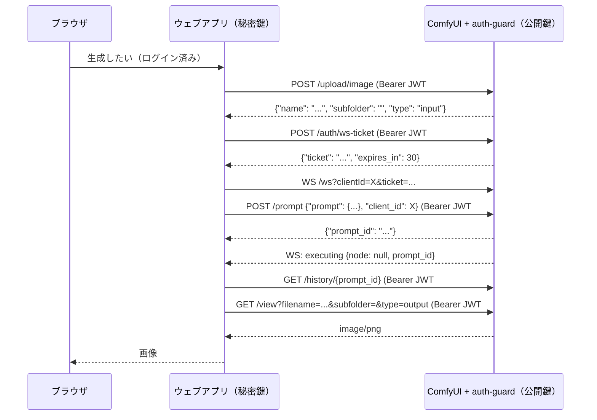

# comfyui-auth-guard

ComfyUI の HTTP API と WebSocket の**全ルート**に認証をかけるカスタムノードです（ワークフロー用のノードは追加しません）。
Cloudflare Tunnel と Access の内側に置く「二重目の守り」を想定しています。

## 目次
1. [仕組み](#1-仕組み)
2. [インストール](#2-インストール)
3. [デフォルト時の挙動](#3-デフォルト時の挙動)
4. [環境変数の設定方法](#4-環境変数の設定方法)
5. [構成レシピ](#5-構成レシピ)
6. [環境変数リファレンス](#6-環境変数リファレンス)
7. [API仕様（リクエストを送る側の実装）](#7-api仕様リクエストを送る側の実装)
8. [GUIログイン](#8-guiログイン)
9. [テスト](#9-テスト)
10. [トラブルシューティング](#10-トラブルシューティング)
11. [制限・注意](#11-制限注意)
12. [ライセンス](#12-ライセンス)

---

## 1. 仕組み
ComfyUI（`main.py`）の起動順は `PromptServer()` 生成 → カスタムノード読み込み → `add_routes()` → `AppRunner.setup()`（ここで aiohttp の middleware リストが凍結）です。
このノードは読み込み時に `PromptServer.instance.app.middlewares.insert(0, ...)` を実行し、**一番外側**の middleware として登録します。すべてのリクエストは ComfyUI の処理より先にここを通ります。
（確認したバージョン：ComfyUI master `ba99487`、2026-10-14）

判定の順番：
1. 設定エラーがあれば 503
2. `/auth/login`・`/auth/logout`（GUIが `login` でなければ 404）
3. `COMFY_AUTH_ALLOWLIST` のパスは素通し
4. GUI が `deny` で画面のパスなら 403
5. `?ticket=` 付きなら WebSocket チケットで判定
6. GUI が `login` なら Cookie セッションで判定
7. ヘッダー認証（token / cf / jwt を `COMFY_AUTH_MODE` に従って）
8. 未認証：GUIログイン有効かつブラウザの画面要求なら 302、それ以外は 401

## 2. インストール
1. このフォルダを `ComfyUI/custom_nodes/comfyui-auth-guard/` に置きます（`__init__.py` がその直下に来るように）。
2. ComfyUI と同じ Python に PyJWT を入れます（JWT・Cloudflare Access を使う場合は必須）。
   - 通常：`python -m pip install "pyjwt[crypto]"`
   - ComfyUI portable：`python_embeded\python.exe -m pip install "pyjwt[crypto]"`
3. 環境変数を設定して（[4章](#4-環境変数の設定方法)）ComfyUI を起動します。
4. 起動ログに次の行が出ることを確認します。**出ていなければ認証は効いていません。**
   ```
   [auth-guard] enabled: mode=all methods=jwt gui=off cf=off query_token=False allowlist=[]
   ```

## 3. デフォルト時の挙動
### 何も設定しない場合
認証方式が1つもないので、**すべてのリクエスト（画面・API・WebSocket）を 503 で拒否**します（fail closed）。
```
[auth-guard] config error: no authentication method configured -> refusing ALL requests (fail closed)
```
```json
{"error": "auth guard misconfigured (fail closed)"}
```
認証を外したいときは `COMFY_AUTH_DISABLED=1` を明示します（またはこのフォルダを外します）。

### 最小構成ごとの挙動
| 設定したもの | 結果 |
|---|---|
| なし | 全部 503 |
| `COMFY_AUTH_TOKEN`（32文字以上） | 固定トークン必須。画面もトークンが必要（ブラウザでは実質使えない） |
| `COMFY_AUTH_TOKEN`（31文字以下） | 全部 503 |
| `COMFY_AUTH_PUBKEY_PATH` だけ | `COMFY_AUTH_JWT_AUD` がないので全部 503 |
| `COMFY_AUTH_PUBKEY_PATH` + `COMFY_AUTH_JWT_AUD` | Ed25519 JWT 必須 |
| `COMFY_AUTH_CF_TEAM` だけ | `COMFY_AUTH_CF_AUD` がないので全部 503 |
| 2つ以上の方式 | `COMFY_AUTH_MODE=auto` なので**全部必須** |
| `COMFY_AUTH_GUI=login` だけ | 認証方式がないので全部 503（API用の方式も1つ必要） |

### 各オプションの既定値
| 項目 | 既定 |
|---|---|
| モード | `auto`（設定済みの方式をすべて必須） |
| GUI | `off`（ログイン画面なし、Cookie無視） |
| WebSocket の `?token=` | 無効 |
| JWT の最大寿命（`exp - iat`） | 300秒 |
| 時計のずれの許容 | JWT 10秒 / Cloudflare Access JWT 30秒 |
| 使用済み `jti` の記憶 | 10000件 |
| WebSocket チケット | 30秒・1回限り |
| GUIセッション | 12時間 |
| Cookie の Secure | `auto`（HTTPS のときだけ） |
| 許可リスト | なし |
| `CF-Connecting-IP` | 信用しない |

### 読み込み失敗時の注意
このノードの読み込みが失敗すると（構文エラー、依存不足など）、ComfyUI は `IMPORT FAILED` を表示して**認証なしで起動を続けます**。`--disable-all-custom-nodes` でも同様です。環境変数の値の誤り（数値欄に文字を入れた等）や初期化中の予期しない例外では、読み込み失敗にはせず**全リクエストを 503 で拒否**します。それでも Python の依存不足・構文エラーなどノード自体が読み込めない場合は防げないので、必ず起動ログの `[auth-guard] enabled` を確認し、ComfyUI は `127.0.0.1` だけで待ち受けてください。

## 4. 環境変数の設定方法
このノードは**起動時に ComfyUI プロセスの環境変数（`os.environ`）を1回だけ読みます**。変更したら ComfyUI を再起動してください。
`.env` ファイルの自動読み込みには**対応していません**（必要なら起動スクリプトで読み込んでから起動してください）。
値に `$` を含むもの（GUIのパスワードハッシュ）は、シェルによって展開されないよう引用符に注意してください。

### Windows PowerShell
```powershell
cd C:\ComfyUI
$env:COMFY_AUTH_PUBKEY_PATH = "C:\comfy-keys\public.pem"
$env:COMFY_AUTH_JWT_AUD     = "comfyui"
# $ を含む値はシングルクォート
$env:COMFY_AUTH_GUI_PASSWORD_HASH = 'scrypt$32768$8$1$....$....'
python main.py --listen 127.0.0.1
```
`$env:` はそのウィンドウの中だけ有効です。

### Windows コマンドプロンプト / .bat
```bat
set COMFY_AUTH_PUBKEY_PATH=C:\comfy-keys\public.pem
set COMFY_AUTH_JWT_AUD=comfyui
set "COMFY_AUTH_GUI_PASSWORD_HASH=scrypt$32768$8$1$....$...."
python main.py --listen 127.0.0.1
```
`=` の前後に空白を入れないでください（値に空白が入ります）。cmd では `$` はそのままで大丈夫です。`%` を含む値は .bat 内で `%%` にします。

### ComfyUI portable（`run_nvidia_gpu.bat` など）
`run_nvidia_gpu.bat`（または `run_cpu.bat`）をメモ帳で開き、Python を起動する行の**前**に `set` 行を足します。
```bat
set COMFY_AUTH_PUBKEY_PATH=C:\comfy-keys\public.pem
set COMFY_AUTH_JWT_AUD=comfyui
.\python_embeded\python.exe -s ComfyUI\main.py --windows-standalone-build
pause
```
アップデートで bat が上書きされることがあるので、コピーして `run_secure.bat` のような別名で使うのがおすすめです。

### Linux / macOS（bash, zsh）
```bash
export COMFY_AUTH_PUBKEY_PATH=$HOME/comfy-keys/public.pem
export COMFY_AUTH_JWT_AUD=comfyui
export COMFY_AUTH_GUI_PASSWORD_HASH='scrypt$32768$8$1$....$....'   # $ を含むのでシングルクォート
python main.py --listen 127.0.0.1
```
1回だけなら `COMFY_AUTH_JWT_AUD=comfyui COMFY_AUTH_PUBKEY_PATH=... python main.py` のように前に書くこともできます。
systemd なら `Environment=` か `EnvironmentFile=` を使います。

### Docker Compose
```yaml
services:
  comfyui:
    # ...
    environment:
      COMFY_AUTH_PUBKEY_PATH: /keys/public.pem
      COMFY_AUTH_JWT_AUD: comfyui
      COMFY_AUTH_GUI: "off"
      # compose では $ を $$ と書く
      # COMFY_AUTH_GUI_PASSWORD_HASH: "scrypt$$32768$$8$$1$$....$$...."
    volumes:
      - ./keys/public.pem:/keys/public.pem:ro
```
`env_file: comfy-auth.env` も使えます（compose 側の機能です）。秘密の値は compose ファイルに直接書かず、`env_file` を権限を絞ったファイルにしてください。

## 5. 構成レシピ
鍵作成などのコマンドは、`pyjwt[crypto]` が入った Python で実行します。

### (a) ウェブアプリから JWT だけで使う（おすすめ）
1. **ウェブアプリ側で**鍵を作ります。
   ```bash
   python tools/issue_token.py keygen --out keys
   # 既に keys/private.pem があると上書きせずに終了します。Windows では 0600 が効かないので、keys フォルダのアクセス権を自分だけにしてください
   ```
   - `keys/private.pem`：**秘密鍵。ウェブアプリのサーバーだけに置く**（ComfyUI のPCには置かない）
   - `keys/public.pem`：公開鍵。ComfyUI のPCの任意の場所（例 `C:\comfy-keys\public.pem`）にコピー
2. ComfyUI 側：
   ```powershell
   $env:COMFY_AUTH_PUBKEY_PATH = "C:\comfy-keys\public.pem"
   $env:COMFY_AUTH_JWT_AUD = "comfyui"
   python main.py --listen 127.0.0.1
   ```
3. ウェブアプリは [7章](#7-api仕様リクエストを送る側の実装) の通り、リクエストごとに JWT を発行して送ります。
4. 動作確認：
   ```bash
   T=$(python tools/issue_token.py issue --key keys/private.pem --aud comfyui --sub test)
   curl -H "Authorization: Bearer $T" http://127.0.0.1:8188/system_stats   # 200
   curl http://127.0.0.1:8188/system_stats                                # 401
   ```

### (b) JWT + GUI ログイン
(a) に加えて：
1. パスワードハッシュを作ります（12文字以上。入力は画面に出ません）。
   ```bash
   python tools/issue_token.py gui-hash
   ```
2. ComfyUI 側に追加：
   ```powershell
   $env:COMFY_AUTH_GUI = "login"
   $env:COMFY_AUTH_GUI_PASSWORD_HASH = 'scrypt$32768$8$1$....$....'
   # Cookie の署名鍵を固定したい場合のみ（32バイト以上。固定しても再起動でログアウトされます）
   # $env:COMFY_AUTH_SESSION_SECRET = '...'
   # Cloudflare Tunnel 経由なら
   $env:COMFY_AUTH_TRUST_CF_IP = "1"
   ```
3. ブラウザで ComfyUI を開くと `/auth/login` に移動するので、パスワードでログインします。

### (c) API だけ・GUI は完全に禁止
(a) に加えて `COMFY_AUTH_GUI=deny`。画面（`/`、JS、CSS など）は正しい JWT があっても 403、API は使えます。

### (d) 動作確認用の固定トークン
```powershell
$env:COMFY_AUTH_TOKEN = python -c "import secrets;print(secrets.token_urlsafe(32))"
python main.py --listen 127.0.0.1
```
クライアントは `X-ComfyUI-Token: <token>` か `Authorization: Bearer <token>`。漏れると無期限に使えるので、本番は (a) にしてください。

## 6. 環境変数リファレンス
| 変数 | 値 | 既定 | 必要になる条件 | 効果 |
|---|---|---|---|---|
| `COMFY_AUTH_DISABLED` | `1`/`true`/`yes`/`on` | 無効 | — | 認証を完全にオフ（警告ログ） |
| `COMFY_AUTH_MODE` | `auto` `token` `cf` `jwt` `all` `any` | `auto` | — | `auto`/`all`：設定済みの方式すべて必須、`any`：どれか1つ、`token`/`cf`/`jwt`：その方式のみ |
| `COMFY_AUTH_TOKEN` | 文字列 | なし | token 方式 | 固定トークン |
| `COMFY_AUTH_MIN_TOKEN_LEN` | 整数 | `32` | — | 固定トークンの最小長 |
| `COMFY_AUTH_ALLOW_QUERY_TOKEN` | 真偽 | `0` | — | WebSocket で `?token=<固定トークン>` を許可 |
| `COMFY_AUTH_PUBKEY_PATH` | パス | なし | jwt 方式（これか下） | Ed25519 公開鍵 PEM ファイル |
| `COMFY_AUTH_PUBKEY` | PEM 文字列 | なし | jwt 方式（これか上） | 公開鍵の本文（こちらが優先） |
| `COMFY_AUTH_JWT_AUD` | 文字列 | なし | jwt 方式では必須 | JWT の `aud` と照合 |
| `COMFY_AUTH_JWT_ISS` | 文字列 | なし | — | 設定すると `iss` 必須・照合 |
| `COMFY_AUTH_MAX_TTL` | 秒 | `300` | — | `exp - iat` の上限 |
| `COMFY_AUTH_LEEWAY` | 秒 | `10` | — | Ed25519 JWT の時計ずれ許容（Cloudflare Access の JWT は 30 秒固定） |
| `COMFY_AUTH_JTI_MAX` | 件数 | `10000` | — | 使用済み `jti` の記憶数。満杯なら拒否 |
| `COMFY_AUTH_TICKET_TTL` | 秒 | `30` | — | WebSocket チケットの寿命 |
| `COMFY_AUTH_CF_TEAM` | `myteam` か `myteam.cloudflareaccess.com` | なし | cf 方式（AUD と両方） | Access の発行元 |
| `COMFY_AUTH_CF_AUD` | AUD タグ | なし | cf 方式（TEAM と両方） | Access JWT の `aud` |
| `COMFY_AUTH_CF_JWKS_URL` | URL | 自動 | — | JWKS URL の上書き（テスト用） |
| `COMFY_AUTH_ALLOWLIST` | `/a,/b` | なし | — | 認証なしで通すパス（完全一致） |
| `COMFY_AUTH_GUI` | `off` `deny` `login` | `off` | — | [8章](#8-guiログイン) |
| `COMFY_AUTH_GUI_PASSWORD_HASH` | `scrypt$N$r$p$salt$hash` | なし | `GUI=login` で必須 | GUI パスワード |
| `COMFY_AUTH_SESSION_SECRET` | 32バイト以上 | 起動ごとにランダム | — | Cookie 署名鍵 |
| `COMFY_AUTH_SESSION_TTL` | 秒 | `43200` | — | GUIセッションの寿命 |
| `COMFY_AUTH_COOKIE_SECURE` | `auto` `1` `0` | `auto` | — | Cookie の Secure 属性 |
| `COMFY_AUTH_ALLOWED_ORIGINS` | `https://a.example,...` | なし | — | 自分の Host 以外に許可する Origin |
| `COMFY_AUTH_TRUST_CF_IP` | 真偽 | `0` | — | ログイン回数制限に `CF-Connecting-IP` を使う |

設定値が不正（範囲外・片方だけ・読めない鍵など）な場合は、すべて**503 で全拒否**になり、ログに `config error: ...` が出ます。

## 7. API仕様（リクエストを送る側の実装）
### 7.1 認証ヘッダー
| 方式 | ヘッダー |
|---|---|
| jwt | `Authorization: Bearer <JWT>` または `X-ComfyUI-JWT: <JWT>` |
| token | `X-ComfyUI-Token: <token>` または `Authorization: Bearer <token>` |
| cf | `Cf-Access-Jwt-Assertion: <JWT>`（Cloudflare Access が自動で付与。自分で付けるものではありません） |

`token` と `jwt` を両方必須にする場合は、`X-ComfyUI-Token` と `Authorization: Bearer <JWT>` に分けてください。

### 7.2 JWT（Ed25519）の仕様
- ヘッダー：`{"alg": "EdDSA", "typ": "JWT"}`。`alg` が `EdDSA` 以外（`HS256`、`RS256`、`none` など）は拒否。`typ` は任意
- 署名：Ed25519 秘密鍵（PKCS#8 PEM）
- クレーム：

| クレーム | 必須 | 内容 |
|---|---|---|
| `aud` | ○ | `COMFY_AUTH_JWT_AUD` と一致（文字列か配列） |
| `iat` | ○ | 発行時刻（UNIX秒、**整数**）。サーバー時刻 + 10秒より未来なら拒否 |
| `exp` | ○ | 期限（UNIX秒、**整数**）。`exp - iat` ≤ `COMFY_AUTH_MAX_TTL`（既定300） |
| `jti` | ○ | 一意な ID（空文字不可）。**同じ `jti` は2回使えません** |
| `iss` | `COMFY_AUTH_JWT_ISS` 設定時 | 一致必須 |
| `sub` | 任意 | 利用者 ID。ログとチケットのひも付けに使用 |
| `scope` | 任意 | ログに出し、`request["auth_scope"]` に入れるだけ |

- 時計のずれは ±10秒（`COMFY_AUTH_LEEWAY`）まで許容。
- **リクエストごとに新しい JWT（新しい `jti`）を作ってください。** 同じ JWT を使い回すと2回目から 401 です。寿命は 60秒程度がおすすめです。

### 7.3 エラーレスポンス
本文はすべて JSON（ログインの 401/429 は HTML のログイン画面）。

| ステータス | 本文 | 起きる場面 |
|---|---|---|
| 401 | `{"error": "unauthorized"}` | 認証なし・不正・期限切れ・リプレイ・チケット無効。`WWW-Authenticate: Bearer realm="comfyui"` 付き |
| 401 | `{"error": "ticket only valid for websocket"}` | `?ticket=` を WebSocket 以外で使った |
| 403 | `{"error": "GUI disabled"}` | `GUI=deny` で画面のパス |
| 403 | `{"error": "origin check failed"}` | Cookie 認証で Origin 不一致（GUIログイン時） |
| 404 | `{"error": "not found"}` | GUI が `login` でないときの `/auth/login` `/auth/logout` |
| 405 | `{"error": "method not allowed"}` | `/auth/ws-ticket` を POST 以外で、など |
| 429 | （HTML、`Retry-After` ヘッダー） | GUIログインの試行回数超過 |
| 503 | `{"error": "auth guard misconfigured (fail closed)"}` | 設定エラー |
| 503 | `{"error": "ticket store full"}` / `{"error": "session store full"}` | 保存領域が満杯 |
| 302 | （`Location: /auth/login?next=...`） | GUIログイン有効時、未認証のブラウザの画面要求 |

認証を通ったあとのエラー（例：ワークフロー不正の 400）は ComfyUI 本体の応答です。

### 7.4 `POST /auth/ws-ticket`
WebSocket 接続用の使い捨てチケットを発行します（`/api/auth/ws-ticket` も同じ）。
- リクエスト：`POST`、本文なし、通常の認証ヘッダー（またはGUIの Cookie）が必要
- レスポンス 200（`Cache-Control: no-store`）：
  ```json
  {"ticket": "<43文字のランダム文字列>", "expires_in": 30}
  ```
- チケットは `expires_in` 秒以内に**1回だけ**使えます。成功・失敗にかかわらず、使った時点で消えます。

### 7.5 WebSocket `/ws`
次のどれかで接続します。
- `ws://host:8188/ws?clientId=<uuid>&ticket=<ticket>`（ブラウザはこれ）
- 認証ヘッダー付きで `ws://host:8188/ws?clientId=<uuid>`（サーバー間なら可）
- GUIログイン時は Cookie + 正しい `Origin`

`?token=<固定トークン>` は既定で無効です（URL がログに残るため）。

### 7.6 典型的な流れ

JWT はリクエストごとに作り直します（#1〜#5 はすべて別の `jti`）。ブラウザに直接 WebSocket をつながせる場合は、ウェブアプリがチケットを取得してブラウザに渡します。

### 7.7 Python の例（実動確認済み）
`examples/client_python.py`。`pip install requests websocket-client "pyjwt[crypto]"`
```python
def auth():
    """New token for EVERY request (jti is single-use)."""
    now = int(time.time())
    tok = jwt.encode({"aud": AUD, "sub": "webapp-user-1", "iat": now, "exp": now + 60,
                      "jti": secrets.token_urlsafe(16), "scope": "generate"}, KEY, algorithm="EdDSA")
    return {"Authorization": f"Bearer {tok}"}

requests.get(f"{URL}/system_stats", headers=auth())
up = requests.post(f"{URL}/upload/image", headers=auth(),
                   files={"image": ("in.png", f, "image/png")}, data={"overwrite": "true"}).json()
ticket = requests.post(f"{URL}/auth/ws-ticket", headers=auth()).json()["ticket"]
ws = websocket.create_connection(f"ws://127.0.0.1:8188/ws?clientId={client_id}&ticket={ticket}")
pid = requests.post(f"{URL}/prompt", headers=auth(),
                    json={"prompt": workflow, "client_id": client_id}).json()["prompt_id"]
# ... ws で {"type":"executing","data":{"node":null,"prompt_id":pid}} を待つ
hist = requests.get(f"{URL}/history/{pid}", headers=auth()).json()[pid]
img = requests.get(f"{URL}/view", headers=auth(), params=hist["outputs"]["2"]["images"][0])
```
実行：`COMFY_URL=http://127.0.0.1:8188 COMFY_PRIVKEY=keys/private.pem INPUT_IMAGE=in.png python examples/client_python.py`

### 7.8 Node.js の例（実動確認済み）
`examples/client_node.mjs`。Node 18 以上、`npm install jose ws`
```js
async function auth() {
  const t = await new SignJWT({ scope: "generate" })
    .setProtectedHeader({ alg: "EdDSA", typ: "JWT" })
    .setSubject("webapp-user-1").setAudience(AUD)
    .setIssuedAt().setExpirationTime("60s").setJti(randomUUID())
    .sign(key);   // key = await importPKCS8(pem, "EdDSA")
  return { Authorization: `Bearer ${t}` };
}
const { ticket } = await (await fetch(URL_ + "/auth/ws-ticket", { method: "POST", headers: await auth() })).json();
const ws = new WebSocket(`ws://127.0.0.1:8188/ws?clientId=${clientId}&ticket=${ticket}`);
const { prompt_id } = await (await fetch(URL_ + "/prompt", { method: "POST",
  headers: { "Content-Type": "application/json", ...(await auth()) },
  body: JSON.stringify({ prompt: workflow, client_id: clientId }) })).json();
```
Node 20 では Ed25519 について `ExperimentalWarning` が出ますが動作します。

ブラウザ側の JavaScript で JWT を作ってはいけません（秘密鍵が漏れます）。ブラウザはウェブアプリ経由で ComfyUI を使うか、ウェブアプリから受け取ったチケットで WebSocket だけつなぎます。

## 8. GUIログイン
| `COMFY_AUTH_GUI` | 動作 |
|---|---|
| `off`（**既定**） | ログイン機能なし。`/auth/login` `/auth/logout` は 404、Cookie は無視。画面もヘッダー認証が必要（ブラウザでは実質使えない） |
| `deny` | `off` に加え、画面のパスは**正しいヘッダー認証があっても 403** |
| `login` | パスワードでログインし、Cookie で画面と API を使える |

`deny` で画面とみなすパス：`/`、`/index.html`、`/assets/` `/extensions/` `/templates/` `/fonts/` `/docs/` `/scripts/` `/lib/` で始まるもの、`.html .js .mjs .css .map .ico .svg .woff .woff2 .ttf .webmanifest` で終わるもの（`/api/` で始まるものは除く）。

`login` の動き：
- ハッシュ形式：`scrypt$<N>$<r>$<p>$<salt base64>$<hash base64>`（N は 2^14 以上の2のべき乗、既定 N=32768,r=8,p=1）。`tools/issue_token.py gui-hash` で作成
- `GET /auth/login`：外部ファイルなしの最小フォーム（CSP 付き）
- `POST /auth/login`（フォーム `password`, `next`）：成功で 303 → `next`、Cookie `comfy_auth_session`（`HttpOnly; SameSite=Strict; Path=/`、HTTPS時 `Secure`）。中身は「セッションID.発行時刻.期限.HMAC-SHA256署名」
- `POST /auth/logout`：サーバー側のセッションを削除（そのCookieは以後無効）
- ログインのたびにセッションIDを作り直します
- `next` は同じサイト内の `/` で始まるパスだけ（`//evil.com` などは `/`）
- **CSRF**：Cookie 認証の `POST/PUT/DELETE/PATCH`・WebSocket・ログイン・ログアウトは `Origin`（なければ `Referer`）が自分の Host か `COMFY_AUTH_ALLOWED_ORIGINS` と一致しないと 403。ヘッダー認証のリクエストは確認しません
- **総当たり対策**：IPごとに5回まで待ちなし、以降 2,4,8…秒（最大15分）ロック（正しいパスワードでも 429）。全体で60秒に50回を超える失敗があれば60秒間全ログイン停止
- **重要**：正しい Cookie セッションは `COMFY_AUTH_MODE` の条件（`all` を含む）を満たしたものとして扱います。Access の守りも残したい場合は Cloudflare 側でホスト全体を Access で保護してください

## 9. テスト
```bash
pip install "pyjwt[crypto]" pytest pytest-aiohttp
cd tests && python -m pytest -v                         # 単体テスト（ComfyUI 不要）
./integration_real_comfyui.sh /path/to/ComfyUI python    # 実物の ComfyUI(--cpu) を起動して確認
```

## 10. トラブルシューティング
| 症状 | 原因と対処 |
|---|---|
| 起動ログに `[auth-guard] enabled` がない | 読み込み失敗（**認証なしで動いています**）。`IMPORT FAILED` の行と直前のエラーを確認。`pyjwt[crypto]` を ComfyUI と同じ Python に入れたか確認 |
| すべて 503 | `config error: ...` のログを確認。数値の環境変数に数字以外を入れた・未設定・トークン31文字以下・AUD 不足・公開鍵が読めない、など |
| 1回目は 200、同じトークンで2回目が 401 | `jti` の使い回し。リクエストごとに JWT を作る |
| JWT がいつも 401 | ログの理由を確認：`ExpiredSignatureError`（期限切れ・時計ずれ）、`InvalidAudienceError`（aud不一致）、`ImmatureSignatureError`（iat が未来）、`InvalidAlgorithmError`（alg が EdDSA でない）、`ttl too long`（`exp-iat` が長すぎ）、`InvalidSignatureError`（鍵ペア違い） |
| PCの時計がずれている | Windows の「時刻を自動的に設定」を有効にする |
| WebSocket が 401 | ブラウザはヘッダーを付けられないのでチケットを使う。チケットは30秒・1回限り |
| `$env:...` で設定したのに効かない | 別のウィンドウや portable の bat から起動している。起動するのと同じウィンドウ / bat で設定 |
| パスワードハッシュが壊れる | `$` が展開されている。PowerShell・bash はシングルクォート、compose は `$$` |
| GUI で 403 `origin check failed` | 別ドメイン経由でアクセスしている。`COMFY_AUTH_ALLOWED_ORIGINS` にそのオリジンを追加 |
| 再起動するとログアウトされる | セッションはメモリ保存のため仕様です |

## 11. 制限・注意
- **同じプロセスで動く**ため、悪意あるカスタムノードは middleware を外せます。本命の守りは Access と、ComfyUI の外の中継役です。
- 読み込みに失敗すると認証なしで起動します（[3章](#読み込み失敗時の注意)）。
- 使用済み `jti`・チケット・GUIセッション・ログイン回数の記録は**プロセスのメモリ**にあり、再起動で消え、複数プロセス間で共有されません。JWT は最長 `MAX_TTL` 秒なので、リプレイの危険は再起動直後の数分に限られます。
- `COMFY_AUTH_ALLOW_QUERY_TOKEN=1` は固定トークンが URL に残るので非推奨。チケットも URL に入りますが30秒・1回限りです。
- `scope` は記録するだけで操作の制限はしません。GUI のパスワードは1つで、ユーザーの区別はしません。
- `CF-Connecting-IP` は偽装できるので既定では使いません。`X-Forwarded-Proto` は Secure を付ける方向にしか効きません。
- `deny` の画面判定はパスの形によるため、ComfyUI の画面構成が変わると漏れが出る可能性があります。
- ComfyUI の内部構造が変わると効かなくなる可能性があります。アップデート後は `tests/integration_real_comfyui.sh` で確認してください。
- CORS のプリフライト（OPTIONS）も認証が必要なため拒否されます。
- ログイン回数制限は「判定→パスワード照合→失敗の記録」の順なので、同時に大量のログインを送ると、ロックがかかる前に数回ぶん余分に試せます（全体の上限 50回/分 で抑えています）。また全体ロックは、攻撃中は正規ユーザーもログインできなくなる（DoS）ことを意味します。
- Tunnel 経由では `request.remote` が全員 `127.0.0.1` になるため、`COMFY_AUTH_TRUST_CF_IP=1` にしないとIP別の制限は全員共通になります。ただし `1` にする場合は、ComfyUI に Tunnel 以外から届かないことが前提です。
- Cloudflare Access の JWT に知らない `kid` が付いていると、そのたびに JWKS を取りに行きます（PyJWT の仕様）。Access の手前で弾かれるので通常は問題になりません。
- `COMFY_AUTH_ALLOWLIST` はパスの完全一致です。`/api/xxx` と `/xxx` は別扱いなので両方書く必要があります。`%2F` を含むパスは許可リストの対象外です。

## 12. ライセンス
MIT License（`LICENSE` を参照）。
