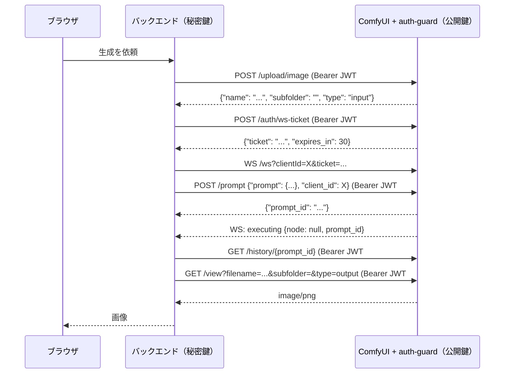

# comfyui-auth-guard

ComfyUI の HTTP API、WebSocket、画面のすべてのルートに認証をかけるカスタムノードです。ワークフロー用のノードは追加しません。

## English summary

comfyui-auth-guard is a ComfyUI custom node that adds authentication to every HTTP route, the WebSocket and the web UI of ComfyUI. It installs an aiohttp middleware in front of all ComfyUI handlers. Features:

- static bearer token, short-lived Ed25519-signed JWTs (single-use `jti`), and Cloudflare Access JWTs, alone or combined
- single-use WebSocket tickets for clients that cannot send headers
- optional password login for the ComfyUI web UI (scrypt, signed HttpOnly cookie, Origin check, brute-force lockout), or a mode that blocks the UI entirely
- fail-closed behaviour: with no or invalid configuration every request is rejected with 503

It is meant as an additional layer behind a reverse proxy, tunnel or firewall, not as the only protection. Because it runs inside the ComfyUI process, a malicious custom node can disable it. Configuration is done with environment variables (see the table in section 6). The detailed documentation below is in Japanese.

## 目次
1. [概要と使いどころ](#1-概要と使いどころ)
2. [セキュリティモデルと制限](#2-セキュリティモデルと制限)
3. [インストール](#3-インストール)
4. [クイックスタート](#4-クイックスタート)
5. [デフォルトの挙動](#5-デフォルトの挙動)
6. [設定（環境変数）](#6-設定環境変数)
7. [構成レシピ](#7-構成レシピ)
8. [API 仕様（クライアントの実装）](#8-api-仕様クライアントの実装)
9. [GUI ログイン](#9-gui-ログイン)
10. [ログ](#10-ログ)
11. [トラブルシューティング](#11-トラブルシューティング)
12. [開発とテスト](#12-開発とテスト)
13. [ライセンス](#13-ライセンス)

---

## 1. 概要と使いどころ
ComfyUI 本体には認証の機能がありません。リバースプロキシやトンネルで外に公開したり、LAN 内のほかの端末から使わせたりすると、ComfyUI に届いた人は誰でもワークフローを実行できます。このノードは ComfyUI に届いたリクエストを本体の処理より前に確かめ、認証のないものを拒否します。

想定している使い方は次のとおりです。

- リバースプロキシ（nginx、Caddy など）、トンネル（Cloudflare Tunnel など）、LAN 経由で公開した ComfyUI の API を守る
- 自作のバックエンドサービスから、署名付きの短命トークンで ComfyUI を呼び出す
- ブラウザから ComfyUI の画面を使うときに、パスワードでログインさせる
- Cloudflare Access の内側に置き、Access の JWT をもう一度 ComfyUI 側で確かめる

主な機能は次のとおりです。

| 機能 | 内容 |
|---|---|
| 固定トークン | `Authorization: Bearer` か `X-ComfyUI-Token` で送る、32文字以上のトークン |
| 短命 JWT（Ed25519） | クライアントが秘密鍵で署名し、ComfyUI は公開鍵で確かめる。有効期間は最長300秒、`jti` は1回限り |
| Cloudflare Access | `Cf-Access-Jwt-Assertion` の署名、`aud`、`iss`、期限を確かめる |
| 方式の組み合わせ | 設定した方式をすべて必須にする、どれか1つでよい、1つだけ使う、から選べる |
| WebSocket チケット | ヘッダーを付けられないクライアント向けの、30秒・1回限りのチケット |
| GUI | ログイン画面を出さない（既定）、画面を完全に拒否する、パスワードでログインする、の3通り |
| fail closed | 設定がない、または不正なときは、すべてのリクエストを 503 で拒否する |

### 仕組み
ComfyUI（`main.py`）は `PromptServer()` の生成、カスタムノードの読み込み、`add_routes()`、`AppRunner.setup()` の順に起動します。aiohttp の middleware の一覧は `AppRunner.setup()` で固定されます。このノードは読み込み時に `PromptServer.instance.app.middlewares.insert(0, ...)` を実行し、一番外側の middleware として自分を登録する仕組みです。そのため、すべてのリクエストが ComfyUI の処理より先にここを通ります（動作を確認したバージョンは ComfyUI master `ba99487`、2026-10-14）。

リクエストは次の順で判定します。

1. 設定エラーがあれば 503
2. `/auth/login` と `/auth/logout`（GUI が `login` でなければ 404）
3. `COMFY_AUTH_ALLOWLIST` に書いたパスは認証なしで通す
4. GUI が `deny` で、画面のパスなら 403
5. `?ticket=` が付いていれば WebSocket チケットで判定
6. GUI が `login` なら Cookie のセッションで判定
7. ヘッダーによる認証（token、cf、jwt を `COMFY_AUTH_MODE` に従って判定）
8. 認証できなければ、GUI ログインが有効でブラウザの画面要求なら 302、それ以外は 401

## 2. セキュリティモデルと制限
このノードはネットワーク側の守り（ComfyUI を `127.0.0.1` だけで待ち受ける、リバースプロキシやトンネル、ファイアウォール、Cloudflare Access など）に加える、もう一段の守りです。これだけで ComfyUI をインターネットに直接公開することは想定していません。

- このノードは ComfyUI と同じプロセスで動くため、悪意のあるカスタムノードは middleware を外せます。主な守りは ComfyUI の外側（プロキシやアクセス制御）に置いてください。
- ノードの読み込みに失敗すると（Python の構文エラーや依存ライブラリの不足など）、ComfyUI は `IMPORT FAILED` を表示して、**認証なしのまま起動を続けます**。`--disable-all-custom-nodes` を付けた場合も同じです。起動するたびに、ログに `[auth-guard] enabled` が出ているかを確かめてください。環境変数の値の誤り（数値の欄に文字を入れたなど）や初期化中の予期しない例外では、読み込みを失敗させず、すべてのリクエストを 503 で拒否します。
- 使用済みの `jti`、チケット、GUI のセッション、ログイン失敗の回数はプロセスのメモリに記録します。再起動すると消え、複数のプロセスの間では共有しません。JWT の有効期間は最長 `COMFY_AUTH_MAX_TTL` 秒なので、リプレイの危険は再起動直後の数分に限られます。
- `COMFY_AUTH_ALLOW_QUERY_TOKEN=1` にすると固定トークンが URL に載ってログに残るため、勧めません。チケットも URL に入りますが、30秒・1回限りです。
- `scope` は記録するだけで、操作の制限はしません。GUI のパスワードは1つだけで、ユーザーを区別しません。
- GUI ログインで得た Cookie のセッションは、`COMFY_AUTH_MODE` の条件（`all` を含む）を満たしたものとして扱います。複数の方式を必須にしている場合でも、ログインしたブラウザはそれを飛ばせます。
- `CF-Connecting-IP` は偽装できるので、既定では使いません。`X-Forwarded-Proto` は、Cookie に Secure を付ける方向にしか効きません。
- `deny` の画面判定はパスの形で行うため、ComfyUI の画面構成が変わると判定から漏れるパスが出る可能性があります。
- ComfyUI の内部構造が変わると、効かなくなる可能性があります。ComfyUI を更新したら、`tests/integration_real_comfyui.sh` で動作を確かめてください。
- CORS のプリフライト（OPTIONS）も認証が必要なため、拒否されます。
- ログイン回数の制限は「ロック中かの判定、パスワードの照合、失敗の記録」の順に行います。同時に大量のログインを送ると、ロックがかかる前に数回分だけ余分に試せます（全体の上限の60秒に50回で抑えています）。また全体ロックがかかっている間は、正規のユーザーもログインできません。
- プロキシやトンネルを経由すると、`request.remote` が全員 `127.0.0.1` になり、IP ごとの制限が全員共通になります。Cloudflare 経由なら `COMFY_AUTH_TRUST_CF_IP=1` で IP ごとに分けられますが、ComfyUI に Cloudflare 以外の経路から届かないことが前提です。
- Cloudflare Access の JWT に知らない `kid` が付いていると、そのたびに JWKS を取得し直します（PyJWT の仕様）。Access の手前で弾かれるため、通常は問題になりません。
- `COMFY_AUTH_ALLOWLIST` はパスの完全一致です。`/api/xxx` と `/xxx` は別のパスとして扱うので、両方を書く必要があります。`%2F` を含むパスは許可リストの対象外です。

## 3. インストール
1. `ComfyUI/custom_nodes/` で clone します。`__init__.py` が `custom_nodes/comfyui-auth-guard/` の直下に来るようにしてください。
   ```bash
   cd ComfyUI/custom_nodes
   git clone https://github.com/hirotakakawamura/comfyui-auth-guard.git
   ```
2. ComfyUI と同じ Python に PyJWT を入れます。Ed25519 の JWT と Cloudflare Access を使うときは必須です。固定トークンだけなら不要ですが、付属の `tools/issue_token.py` の `keygen` と `issue` には必要です。
   - venv などの通常の環境では `python -m pip install -r requirements.txt`（中身は `PyJWT[crypto]>=2.8`）
   - ComfyUI portable では `python_embeded\python.exe -m pip install "pyjwt[crypto]"`
   - ComfyUI-Manager から Git URL でインストールした場合は、Manager が `requirements.txt` を読み込みます。
3. 環境変数を設定して（[6章](#6-設定環境変数)）、ComfyUI を起動します。
4. 起動ログに次の行が出ることを確かめます。この行が出ていなければ、認証は効いていません。
   ```
   [auth-guard] enabled: mode=all methods=jwt gui=off cf=off query_token=False allowlist=[]
   ```

## 4. クイックスタート
固定トークンで動作を確かめる最小の手順です（Linux / macOS の例）。

```bash
export COMFY_AUTH_TOKEN=$(python -c "import secrets;print(secrets.token_urlsafe(32))")
python main.py --listen 127.0.0.1
# 別の端末で
curl http://127.0.0.1:8188/system_stats                                          # 401
curl -H "Authorization: Bearer $COMFY_AUTH_TOKEN" http://127.0.0.1:8188/system_stats   # 200
```

固定トークンは漏れると無期限に使えます。継続して使う場合は、[7章](#7-構成レシピ)の (a) の短命 JWT を使ってください。

## 5. デフォルトの挙動
### 何も設定しない場合
認証方式が1つもないため、画面、API、WebSocket のすべてのリクエストを **503 で拒否します**（fail closed）。
```
[auth-guard] config error: no authentication method configured -> refusing ALL requests (fail closed)
```
```json
{"error": "auth guard misconfigured (fail closed)"}
```
認証を外したいときは、`COMFY_AUTH_DISABLED=1` を明示的に設定するか、このフォルダを `custom_nodes` から外します。

### 最小構成ごとの挙動
| 設定したもの | 結果 |
|---|---|
| なし | すべて 503 |
| `COMFY_AUTH_TOKEN`（32文字以上） | 固定トークンが必須。画面にもトークンが必要なので、ブラウザからは実質使えない |
| `COMFY_AUTH_TOKEN`（31文字以下） | すべて 503 |
| `COMFY_AUTH_PUBKEY_PATH` だけ | `COMFY_AUTH_JWT_AUD` がないので、すべて 503 |
| `COMFY_AUTH_PUBKEY_PATH` と `COMFY_AUTH_JWT_AUD` | Ed25519 の JWT が必須 |
| `COMFY_AUTH_CF_TEAM` だけ | `COMFY_AUTH_CF_AUD` がないので、すべて 503 |
| 2つ以上の方式 | `COMFY_AUTH_MODE` の既定が `auto` なので、すべての方式が必須 |
| `COMFY_AUTH_GUI=login` だけ | 認証方式がないので、すべて 503（API 用の方式も1つ必要） |

### 各オプションの既定値
| 項目 | 既定 |
|---|---|
| モード | `auto`（設定した方式をすべて必須にする） |
| GUI | `off`（ログイン画面なし、Cookie は無視） |
| WebSocket の `?token=` | 無効 |
| JWT の最長の有効期間（`exp - iat`） | 300秒 |
| 時計のずれの許容 | Ed25519 の JWT は10秒、Cloudflare Access の JWT は30秒 |
| 使用済みの `jti` の記録 | 10000件 |
| WebSocket チケット | 30秒・1回限り |
| GUI のセッション | 12時間 |
| Cookie の Secure | `auto`（HTTPS のときだけ） |
| 許可リスト | なし |
| `CF-Connecting-IP` | 信用しない |
| ログレベル | `INFO` |

## 6. 設定（環境変数）
このノードは起動時に ComfyUI プロセスの環境変数（`os.environ`）を1回だけ読みます。値を変えたら ComfyUI を再起動してください。`.env` ファイルの自動読み込みには対応していないので、必要なら起動スクリプトで読み込んでから起動してください。値に `$` を含むもの（GUI のパスワードハッシュ）は、シェルに展開されないよう引用符に注意してください。

### 環境変数の一覧
| 変数 | 値 | 既定 | 必要になる条件 | 効果 |
|---|---|---|---|---|
| `COMFY_AUTH_DISABLED` | `1`/`true`/`yes`/`on` | 無効 | — | 認証を完全に止める（警告をログに出す） |
| `COMFY_AUTH_MODE` | `auto` `token` `cf` `jwt` `all` `any` | `auto` | — | `auto` と `all` は設定した方式をすべて必須、`any` はどれか1つ、`token`/`cf`/`jwt` はその方式だけ |
| `COMFY_AUTH_TOKEN` | 文字列 | なし | token 方式 | 固定トークン |
| `COMFY_AUTH_MIN_TOKEN_LEN` | 整数 | `32` | — | 固定トークンの最小の長さ |
| `COMFY_AUTH_ALLOW_QUERY_TOKEN` | 真偽 | `0` | — | WebSocket で `?token=<固定トークン>` を許可する |
| `COMFY_AUTH_PUBKEY_PATH` | パス | なし | jwt 方式（これか下のどちらか） | Ed25519 公開鍵の PEM ファイル |
| `COMFY_AUTH_PUBKEY` | PEM 文字列 | なし | jwt 方式（これか上のどちらか） | 公開鍵の本文（こちらが優先） |
| `COMFY_AUTH_JWT_AUD` | 文字列 | なし | jwt 方式では必須 | JWT の `aud` と照合する値 |
| `COMFY_AUTH_JWT_ISS` | 文字列 | なし | — | 設定すると `iss` が必須になり、照合する |
| `COMFY_AUTH_MAX_TTL` | 秒 | `300` | — | `exp - iat` の上限 |
| `COMFY_AUTH_LEEWAY` | 秒 | `10` | — | Ed25519 の JWT の時計のずれの許容（Cloudflare Access の JWT は30秒で固定） |
| `COMFY_AUTH_JTI_MAX` | 件数 | `10000` | — | 使用済みの `jti` を記録する数。満杯のときは拒否する |
| `COMFY_AUTH_TICKET_TTL` | 秒 | `30` | — | WebSocket チケットの有効期間 |
| `COMFY_AUTH_CF_TEAM` | `myteam` か `myteam.cloudflareaccess.com` | なし | cf 方式（AUD と両方） | Access の発行元 |
| `COMFY_AUTH_CF_AUD` | AUD タグ | なし | cf 方式（TEAM と両方） | Access の JWT の `aud` |
| `COMFY_AUTH_CF_JWKS_URL` | URL | 自動 | — | JWKS の URL を上書きする（テスト用） |
| `COMFY_AUTH_ALLOWLIST` | `/a,/b` | なし | — | 認証なしで通すパス（完全一致） |
| `COMFY_AUTH_GUI` | `off` `deny` `login` | `off` | — | [9章](#9-gui-ログイン)を参照 |
| `COMFY_AUTH_GUI_PASSWORD_HASH` | `scrypt$N$r$p$salt$hash` | なし | `GUI=login` では必須 | GUI のパスワード |
| `COMFY_AUTH_SESSION_SECRET` | 32バイト以上 | 起動ごとにランダム | — | Cookie の署名鍵 |
| `COMFY_AUTH_SESSION_TTL` | 秒 | `43200` | — | GUI のセッションの有効期間 |
| `COMFY_AUTH_COOKIE_SECURE` | `auto` `1` `0` | `auto` | — | Cookie の Secure 属性 |
| `COMFY_AUTH_ALLOWED_ORIGINS` | `https://a.example,...` | なし | — | 自分の Host 以外に許可する Origin |
| `COMFY_AUTH_TRUST_CF_IP` | 真偽 | `0` | — | ログイン回数の制限に `CF-Connecting-IP` を使う |
| `COMFY_AUTH_LOG_LEVEL` | `DEBUG`/`INFO`/`WARNING`/`ERROR` | `INFO` | — | このノードのログだけの出力レベル（[10章](#10-ログ)）。不正な値なら警告を出して `INFO` にする |

値が不正な場合（数値でない、範囲外、片方だけ設定した、鍵が読めないなど）は、すべてのリクエストを 503 で拒否し、ログに `config error: ...` を出します。`COMFY_AUTH_LOG_LEVEL` だけは例外で、不正な値でも拒否はしません。

### 設定の書き方
#### Windows PowerShell
```powershell
cd C:\ComfyUI
$env:COMFY_AUTH_PUBKEY_PATH = "C:\comfy-keys\public.pem"
$env:COMFY_AUTH_JWT_AUD     = "comfyui"
# $ を含む値はシングルクォートで囲む
$env:COMFY_AUTH_GUI_PASSWORD_HASH = 'scrypt$32768$8$1$....$....'
python main.py --listen 127.0.0.1
```
`$env:` で設定した値はそのウィンドウの中だけで有効です。

#### Windows コマンドプロンプト / .bat
```bat
set COMFY_AUTH_PUBKEY_PATH=C:\comfy-keys\public.pem
set COMFY_AUTH_JWT_AUD=comfyui
set "COMFY_AUTH_GUI_PASSWORD_HASH=scrypt$32768$8$1$....$...."
python main.py --listen 127.0.0.1
```
`=` の前後に空白を入れないでください（値に空白が入ります）。cmd では `$` はそのままで問題ありません。`%` を含む値は .bat の中では `%%` と書きます。

#### ComfyUI portable（`run_nvidia_gpu.bat` など）
`run_nvidia_gpu.bat`（または `run_cpu.bat`）をテキストエディターで開き、Python を起動する行の前に `set` の行を足します。
```bat
set COMFY_AUTH_PUBKEY_PATH=C:\comfy-keys\public.pem
set COMFY_AUTH_JWT_AUD=comfyui
.\python_embeded\python.exe -s ComfyUI\main.py --windows-standalone-build
pause
```
アップデートで bat が上書きされることがあるので、コピーして `run_secure.bat` のような別名で使うことを勧めます。

#### Linux / macOS（bash, zsh）
```bash
export COMFY_AUTH_PUBKEY_PATH=$HOME/comfy-keys/public.pem
export COMFY_AUTH_JWT_AUD=comfyui
export COMFY_AUTH_GUI_PASSWORD_HASH='scrypt$32768$8$1$....$....'   # $ を含むのでシングルクォート
python main.py --listen 127.0.0.1
```
1回だけなら、`COMFY_AUTH_JWT_AUD=comfyui COMFY_AUTH_PUBKEY_PATH=... python main.py` のようにコマンドの前に書くこともできます。systemd では `Environment=` か `EnvironmentFile=` を使います。

#### Docker Compose
```yaml
services:
  comfyui:
    # ...
    environment:
      COMFY_AUTH_PUBKEY_PATH: /keys/public.pem
      COMFY_AUTH_JWT_AUD: comfyui
      COMFY_AUTH_GUI: "off"
      # compose では $ を $$ と書く
      # COMFY_AUTH_GUI_PASSWORD_HASH: "scrypt$$32768$$8$$1$$....$$...."
    volumes:
      - ./keys/public.pem:/keys/public.pem:ro
```
`env_file: comfy-auth.env` も使えます（compose 側の機能です）。秘密の値は compose ファイルに直接書かず、アクセス権を絞ったファイルを `env_file` で読み込んでください。

#### ランチャーを使う場合
Stability Matrix などのランチャーから起動する場合は、ランチャーの環境変数の設定欄か、ComfyUI を起動するスクリプトで設定します。ランチャー全体の設定欄に入れた値は、ほかのパッケージにも渡ることがあります。正しく渡っているかは起動ログの `[auth-guard] enabled` で確かめてください。

## 7. 構成レシピ
鍵の作成などのコマンドは`pyjwt[crypto]` を入れた Python で実行します。

### (a) バックエンドサービスから短命 JWT で呼ぶ（推奨）
1. ComfyUI を呼び出す側（バックエンド）で鍵を作ります。
   ```bash
   python tools/issue_token.py keygen --out keys
   ```
   `keys/private.pem` がすでにあると、上書きせずに終了します。Windows ではファイルの権限 0600 が効かないので、`keys` フォルダのアクセス権を自分だけに絞ってください。
   - `keys/private.pem` は秘密鍵です。**呼び出す側のサーバーだけに置き**、ComfyUI のマシンには置きません。
   - `keys/public.pem` は公開鍵です。ComfyUI のマシンの任意の場所（例：`C:\comfy-keys\public.pem`）にコピーします。
2. ComfyUI 側で次のように設定します。
   ```powershell
   $env:COMFY_AUTH_PUBKEY_PATH = "C:\comfy-keys\public.pem"
   $env:COMFY_AUTH_JWT_AUD = "comfyui"
   python main.py --listen 127.0.0.1
   ```
3. 呼び出す側は[8章](#8-api-仕様クライアントの実装)のとおりリクエストごとに JWT を作って送ります。
4. 動作を確かめます。
   ```bash
   T=$(python tools/issue_token.py issue --key keys/private.pem --aud comfyui --sub test)
   curl -H "Authorization: Bearer $T" http://127.0.0.1:8188/system_stats   # 200
   curl http://127.0.0.1:8188/system_stats                                # 401
   ```

### (b) 短命 JWT と GUI ログイン
(a) の設定に、次を加えます。
1. パスワードハッシュを作ります。パスワードは12文字以上で、入力した文字は画面に出ません。このコマンドは標準ライブラリだけで動きます。
   ```bash
   python tools/issue_token.py gui-hash
   ```
2. ComfyUI 側に設定を足します。
   ```powershell
   $env:COMFY_AUTH_GUI = "login"
   $env:COMFY_AUTH_GUI_PASSWORD_HASH = 'scrypt$32768$8$1$....$....'
   # Cookie の署名鍵を固定したい場合だけ（32バイト以上。固定しても再起動するとログアウトされる）
   # $env:COMFY_AUTH_SESSION_SECRET = '...'
   # Cloudflare 経由で公開する場合は、IP ごとのログイン制限のために
   # $env:COMFY_AUTH_TRUST_CF_IP = "1"
   ```
3. ブラウザで ComfyUI を開くと `/auth/login` に移るので、パスワードでログインします。

### (c) API だけを使い、GUI は完全に禁止する
(a) の設定に `COMFY_AUTH_GUI=deny` を加えます。画面（`/`、JS、CSS など）は正しい JWT があっても 403 になり、API は使えます。

### (d) Cloudflare Access の内側に置く
Cloudflare Access で保護したホストの奥に ComfyUI を置く場合、Access がリクエストに付ける JWT を ComfyUI 側でも確かめられます。
```bash
export COMFY_AUTH_CF_TEAM=myteam          # myteam.cloudflareaccess.com の myteam
export COMFY_AUTH_CF_AUD=<Access アプリケーションの AUD タグ>
```
ほかの方式と一緒に設定すると、既定（`auto`）ではすべての方式が必須になります。Access を通らずに届いたリクエストは、`Cf-Access-Jwt-Assertion` がないため 401 になります。

### (e) 動作確認用の固定トークン
```powershell
$env:COMFY_AUTH_TOKEN = python -c "import secrets;print(secrets.token_urlsafe(32))"
python main.py --listen 127.0.0.1
```
クライアントは `X-ComfyUI-Token: <token>` か `Authorization: Bearer <token>` を付けて送ります。漏れると無期限に使えるので、継続して使う場合は (a) にしてください。

## 8. API 仕様（クライアントの実装）
### 8.1 認証ヘッダー
| 方式 | ヘッダー |
|---|---|
| jwt | `Authorization: Bearer <JWT>` または `X-ComfyUI-JWT: <JWT>` |
| token | `X-ComfyUI-Token: <token>` または `Authorization: Bearer <token>` |
| cf | `Cf-Access-Jwt-Assertion: <JWT>`（Cloudflare Access が自動で付けるもので、クライアントが付けるものではありません） |

`token` と `jwt` を両方必須にする場合は、`X-ComfyUI-Token` と `Authorization: Bearer <JWT>` に分けて送ってください。

### 8.2 JWT（Ed25519）の仕様
- ヘッダーは `{"alg": "EdDSA", "typ": "JWT"}` です。`alg` が `EdDSA` 以外（`HS256`、`RS256`、`none` など）のトークンは拒否します。`typ` は任意です。
- Ed25519 の秘密鍵（PKCS#8 PEM）で署名します。
- クレームは次のとおりです。

| クレーム | 必須 | 内容 |
|---|---|---|
| `aud` | ○ | `COMFY_AUTH_JWT_AUD` と一致すること（文字列か配列） |
| `iat` | ○ | 発行時刻（UNIX 秒の整数）。サーバーの時刻に `COMFY_AUTH_LEEWAY`（既定10秒）を足した時刻より未来なら拒否 |
| `exp` | ○ | 期限（UNIX 秒の整数）。`exp - iat` は `COMFY_AUTH_MAX_TTL`（既定300秒）以下 |
| `jti` | ○ | 一意な ID（空文字は不可）。同じ `jti` は2回使えない |
| `iss` | `COMFY_AUTH_JWT_ISS` を設定したとき | 一致すること |
| `sub` | 任意 | 呼び出し元の ID。ログとチケットのひも付けに使う |
| `scope` | 任意 | ログ（DEBUG）に出し、`request["auth_scope"]` に入れるだけ |

- 時計のずれは `COMFY_AUTH_LEEWAY`（既定10秒）まで許容します。
- **リクエストごとに新しい JWT（新しい `jti`）を作ってください。** 同じ JWT を使い回すと、2回目から 401 になります。有効期間は60秒程度を勧めます。

### 8.3 エラーレスポンス
本文はすべて JSON です（ログインの 401 と 429 だけは HTML のログイン画面）。

| ステータス | 本文 | 起きる場面 |
|---|---|---|
| 401 | `{"error": "unauthorized"}` | 認証がない、不正、期限切れ、リプレイ、チケットが無効。`WWW-Authenticate: Bearer realm="comfyui"` 付き |
| 401 | `{"error": "ticket only valid for websocket"}` | `?ticket=` を WebSocket 以外で使った |
| 403 | `{"error": "GUI disabled"}` | `GUI=deny` で画面のパスにアクセスした |
| 403 | `{"error": "origin check failed"}` | Cookie での認証で Origin が一致しない（GUI ログイン時） |
| 404 | `{"error": "not found"}` | GUI が `login` でないときの `/auth/login` と `/auth/logout` |
| 405 | `{"error": "method not allowed"}` | `/auth/ws-ticket` を POST 以外で呼んだ、など |
| 429 | （HTML、`Retry-After` ヘッダー付き） | GUI ログインの試行回数の超過 |
| 503 | `{"error": "auth guard misconfigured (fail closed)"}` | 設定エラー |
| 503 | `{"error": "auth guard failed to initialise (fail closed)"}` | 初期化中の予期しないエラー |
| 503 | `{"error": "ticket store full"}` / `{"error": "session store full"}` | 記録領域が満杯 |
| 302 | （`Location: /auth/login?next=...`） | GUI ログインが有効なときの、未認証のブラウザの画面要求 |

認証を通ったあとのエラー（ワークフローが不正なときの 400 など）は、ComfyUI 本体の応答です。

### 8.4 `POST /auth/ws-ticket`
WebSocket の接続に使う、使い捨てのチケットを発行します（`/api/auth/ws-ticket` も同じです）。
- リクエストは本文なしの `POST` です。通常の認証ヘッダー（または GUI の Cookie）が必要です。
- 成功すると 200（`Cache-Control: no-store`）で次を返します。
  ```json
  {"ticket": "<43文字のランダムな文字列>", "expires_in": 30}
  ```
- チケットは `expires_in` 秒以内に1回だけ使えます。成功しても失敗しても、使った時点で消えます。

### 8.5 WebSocket `/ws`
次のどれかの方法で接続します。
- `ws://host:8188/ws?clientId=<uuid>&ticket=<ticket>`（ブラウザなど、ヘッダーを付けられないクライアント）
- 認証ヘッダーを付けて `ws://host:8188/ws?clientId=<uuid>`（サーバー間の通信）
- GUI ログイン時はCookie と正しい `Origin`

`?token=<固定トークン>` は、URL がログに残るため既定で無効です。

### 8.6 典型的な流れ

JWT はリクエストごとに作り直します（#1〜#5 はすべて別の `jti`）。ブラウザから直接 WebSocket につながせる場合は、バックエンドがチケットを取得してブラウザに渡します。

### 8.7 Python の例
`examples/client_python.py` にあります（実際の ComfyUI で動作を確認済み）。`pip install requests websocket-client "pyjwt[crypto]"` が必要です。
```python
def auth():
    """New token for EVERY request (jti is single-use)."""
    now = int(time.time())
    tok = jwt.encode({"aud": AUD, "sub": "my-backend", "iat": now, "exp": now + 60,
                      "jti": secrets.token_urlsafe(16), "scope": "generate"}, KEY, algorithm="EdDSA")
    return {"Authorization": f"Bearer {tok}"}

requests.get(f"{URL}/system_stats", headers=auth())
up = requests.post(f"{URL}/upload/image", headers=auth(),
                   files={"image": ("in.png", f, "image/png")}, data={"overwrite": "true"}).json()
ticket = requests.post(f"{URL}/auth/ws-ticket", headers=auth()).json()["ticket"]
ws = websocket.create_connection(f"ws://127.0.0.1:8188/ws?clientId={client_id}&ticket={ticket}")
pid = requests.post(f"{URL}/prompt", headers=auth(),
                    json={"prompt": workflow, "client_id": client_id}).json()["prompt_id"]
# ... ws で {"type":"executing","data":{"node":null,"prompt_id":pid}} を待つ
hist = requests.get(f"{URL}/history/{pid}", headers=auth()).json()[pid]
img = requests.get(f"{URL}/view", headers=auth(), params=hist["outputs"]["2"]["images"][0])
```
実行例は `COMFY_URL=http://127.0.0.1:8188 COMFY_PRIVKEY=keys/private.pem INPUT_IMAGE=in.png python examples/client_python.py` です。

### 8.8 Node.js の例
`examples/client_node.mjs` にあります（実際の ComfyUI で動作を確認済み）。Node 18 以上と `npm install jose ws` が必要です。
```js
async function auth() {
  const t = await new SignJWT({ scope: "generate" })
    .setProtectedHeader({ alg: "EdDSA", typ: "JWT" })
    .setSubject("my-backend").setAudience(AUD)
    .setIssuedAt().setExpirationTime("60s").setJti(randomUUID())
    .sign(key);   // key = await importPKCS8(pem, "EdDSA")
  return { Authorization: `Bearer ${t}` };
}
const { ticket } = await (await fetch(URL_ + "/auth/ws-ticket", { method: "POST", headers: await auth() })).json();
const ws = new WebSocket(`ws://127.0.0.1:8188/ws?clientId=${clientId}&ticket=${ticket}`);
const { prompt_id } = await (await fetch(URL_ + "/prompt", { method: "POST",
  headers: { "Content-Type": "application/json", ...(await auth()) },
  body: JSON.stringify({ prompt: workflow, client_id: clientId }) })).json();
```
Node 20 では Ed25519 について `ExperimentalWarning` が出ますが、動作します。

ブラウザの JavaScript で JWT を作らないでください。秘密鍵が漏れます。ブラウザからはバックエンドを経由して ComfyUI を使うか、バックエンドから受け取ったチケットで WebSocket だけをつなぎます。

## 9. GUI ログイン
| `COMFY_AUTH_GUI` | 動作 |
|---|---|
| `off`（既定） | ログイン機能なし。`/auth/login` と `/auth/logout` は 404、Cookie は無視する。画面にもヘッダーでの認証が必要なので、ブラウザからは実質使えない |
| `deny` | `off` の動作に加え、画面のパスは正しいヘッダー認証があっても 403 |
| `login` | パスワードでログインし、Cookie で画面と API を使える |

`deny` で画面とみなすパスは`/`、`/index.html`、`/assets/` `/extensions/` `/templates/` `/fonts/` `/docs/` `/scripts/` `/lib/` で始まるもの、`.html .js .mjs .css .map .ico .svg .woff .woff2 .ttf .webmanifest` で終わるものです（`/api/` で始まるものは除きます）。

`login` の動作は次のとおりです。
- ハッシュの形式は `scrypt$<N>$<r>$<p>$<salt base64>$<hash base64>` です。N は 2^14 以上の2のべき乗で、既定は N=32768、r=8、p=1 です。`tools/issue_token.py gui-hash` で作ります。
- `GET /auth/login` は、外部ファイルを読み込まない最小限のフォームを返します（CSP 付き）。
- `POST /auth/login`（フォームの項目は `password` と `next`）に成功すると、303 で `next` に移り、Cookie `comfy_auth_session`（`HttpOnly; SameSite=Strict; Path=/`、HTTPS のときは `Secure`）を発行します。Cookie の中身は「セッション ID.発行時刻.期限.HMAC-SHA256 の署名」です。
- `POST /auth/logout` は、サーバー側のセッションを削除します。その Cookie は以後使えません。
- ログインするたびにセッション ID を作り直します。
- `next` には同じサイトの中の `/` で始まるパスだけを使えます（`//evil.com` などは `/` に置き換えます）。
- CSRF への対策として、Cookie で認証する `POST/PUT/DELETE/PATCH`、WebSocket、ログイン、ログアウトでは、`Origin`（なければ `Referer`）が自分の Host か `COMFY_AUTH_ALLOWED_ORIGINS` と一致しないと 403 を返します。ヘッダーで認証するリクエストでは確かめません。
- 総当たりへの対策として、IP ごとに5回までは待ち時間なしで、それ以降は 2、4、8…秒（最長15分）ロックします。ロック中は正しいパスワードでも 429 です。全体で60秒に50回を超える失敗があれば、60秒間すべてのログインを止めます。
- 正しい Cookie のセッションは`COMFY_AUTH_MODE` の条件（`all` を含む）を満たしたものとして扱います。Cloudflare Access などの守りも残したい場合は、プロキシ側でホスト全体を保護してください。
- 再起動すると、セッションが消えるためログインし直しになります。

## 10. ログ
- ロガーの名前は `comfyui-auth-guard` です。独自の出力先は持たず、ComfyUI のログ設定（コンソールや `comfyui_detail.log` など）にそのまま流れるので、同じログが2回表示されることはありません。`COMFY_AUTH_LOG_LEVEL` はこのロガーにだけ効き、ComfyUI 本体のログレベルは変えません。
- 成功したリクエストは INFO では記録しません。JWT の `sub` と `scope` は `DEBUG` で出ます。ComfyUI のコンソールに表示するには、ComfyUI 側も `--verbose DEBUG` で起動する必要があります。
- 拒否のログは理由ごとに60秒に1行までにまとめます。まとめて省いた件数は次の行に `(+N similar suppressed in last 60s)` と付きます。対象は未認証の拒否と WebSocket チケットの拒否（INFO）、チケットの持ち主の不一致、Origin の不一致、Cloudflare Access と JWT の検証の失敗、GUI ログインの失敗（WARNING）です。
- 起動時のメッセージ、設定エラー、ログインのロックアウトは、まとめずに毎回出します。
- トークン、JWT、チケット、パスワード、Cookie の値はログに出しません。
- `COMFY_AUTH_LOG_LEVEL` を `WARNING` 以上にすると、起動確認の `[auth-guard] enabled`（INFO）も出なくなります。動作を確かめるときは `INFO` にしてください。

## 11. トラブルシューティング
| 症状 | 原因と対処 |
|---|---|
| 起動ログに `[auth-guard] enabled` がない | `COMFY_AUTH_LOG_LEVEL` が `WARNING` 以上なら、表示されていないだけです。そうでなければ読み込みに失敗していて、**認証なしで動いています**。`IMPORT FAILED` の行とその直前のエラーを確認し、`pyjwt[crypto]` を ComfyUI と同じ Python に入れたかを確かめてください |
| すべて 503 | ログの `config error: ...` を確認してください。数値の環境変数に数字以外を入れた、何も設定していない、トークンが31文字以下、AUD がない、公開鍵が読めない、などが原因です |
| 1回目は 200 で、同じトークンの2回目が 401 | `jti` の使い回しです。リクエストごとに JWT を作ってください |
| JWT がいつも 401 | ログの理由を確認してください。`ExpiredSignatureError`（期限切れか時計のずれ）、`InvalidAudienceError`（aud の不一致）、`ImmatureSignatureError`（iat が未来）、`InvalidAlgorithmError`（alg が EdDSA でない）、`ttl too long`（`exp-iat` が長すぎる）、`InvalidSignatureError`（鍵の組が違う）です |
| マシンの時計がずれている | OS の時刻の自動設定（Windows の「時刻を自動的に設定する」、NTP など）を有効にしてください |
| WebSocket が 401 | ブラウザは WebSocket にヘッダーを付けられないので、チケットを使ってください。チケットは30秒・1回限りです |
| `$env:...` で設定したのに効かない | 別のウィンドウや、portable の bat から起動しています。ComfyUI を起動するのと同じウィンドウか bat で設定してください |
| パスワードハッシュが壊れる | `$` が展開されています。PowerShell と bash ではシングルクォートで囲み、compose では `$$` と書いてください |
| GUI で 403 `origin check failed` | Host とは別のドメイン（プロキシの公開 URL など）からアクセスしています。`COMFY_AUTH_ALLOWED_ORIGINS` にそのオリジンを加えてください |
| 再起動するとログアウトされる | セッションをメモリに保存しているための仕様です |
| ログが多すぎる | 成功したリクエストは INFO では出ず、拒否も60秒に1行にまとめています。さらに減らすなら `COMFY_AUTH_LOG_LEVEL=WARNING` にします（起動確認の `enabled` の行も出なくなります） |

## 12. 開発とテスト
```bash
pip install "pyjwt[crypto]" pytest pytest-aiohttp
cd tests && python -m pytest -v                         # 単体テスト（ComfyUI は不要）
./integration_real_comfyui.sh /path/to/ComfyUI python    # 実際の ComfyUI（--cpu）を起動して確かめる
```
結合テストはポート 8199 で ComfyUI を何度か起動し直して、各モードの応答とログを確かめます。

ファイルの構成は次のとおりです。

| ファイル | 内容 |
|---|---|
| `__init__.py` | ComfyUI からの読み込みと middleware の登録 |
| `auth_guard.py` | 設定の読み込み、認証の判定、WebSocket チケット、ログ |
| `gui.py` | GUI ログイン（パスワードハッシュ、セッション、Origin の確認、回数制限） |
| `tools/issue_token.py` | 鍵の作成、JWT の発行、パスワードハッシュの作成 |
| `examples/` | Python と Node.js のクライアントの例 |
| `tests/` | 単体テストと結合テスト |

## 13. ライセンス
MIT License です。`LICENSE` を参照してください。
